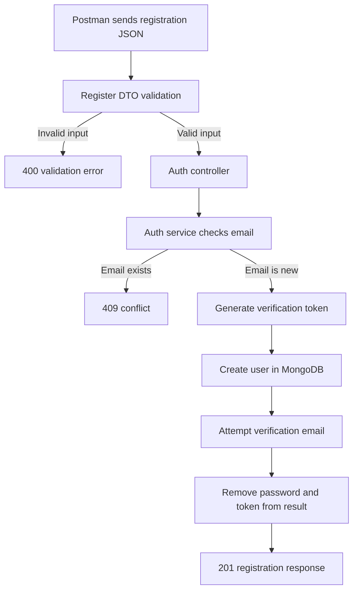
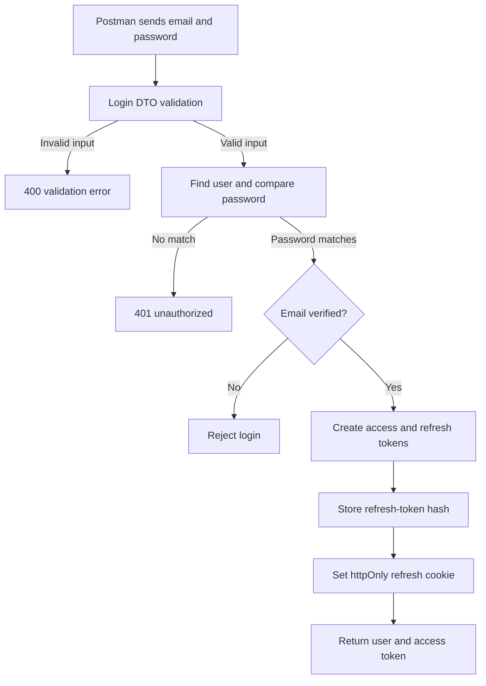
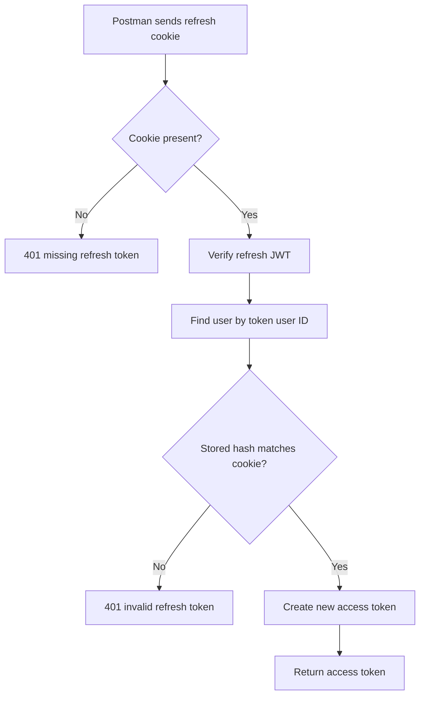
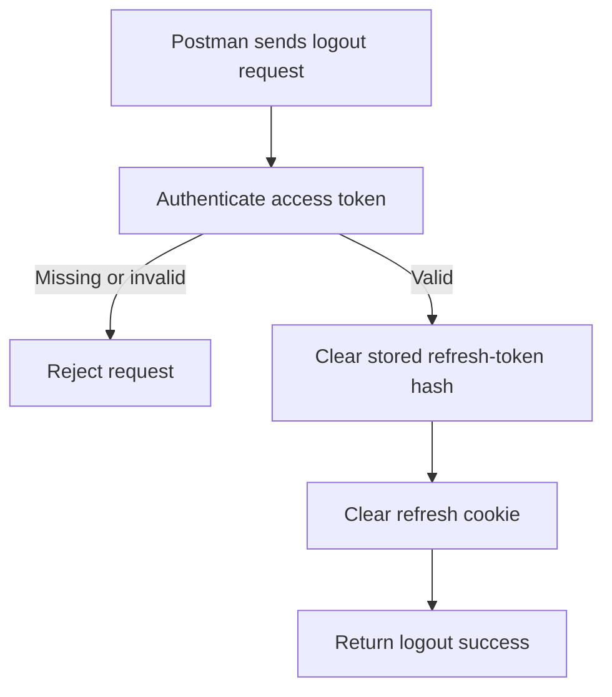
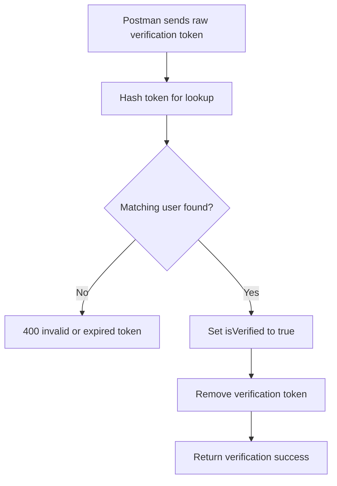
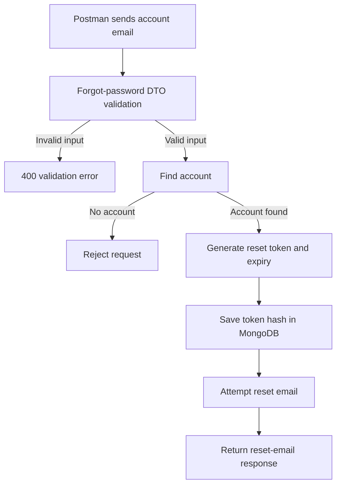
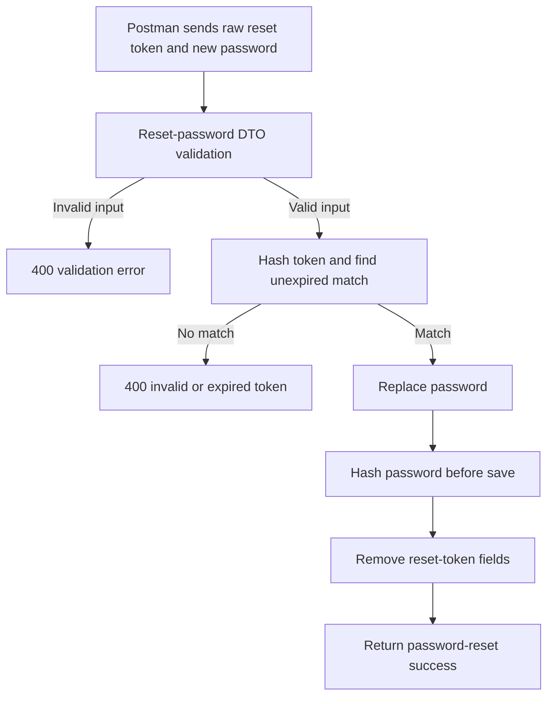
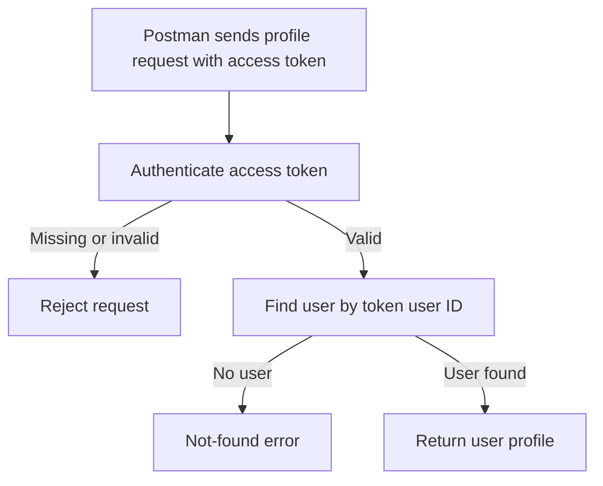

# Postman API Collection Guide

This guide explains how to create a Postman collection and exercise every authentication route declared by this project.

> **Before testing:** The routes describe the intended API, but the application currently has blocking issues and cannot be tested end to end as-is. `auth.routes.js` imports three DTO files that do not exist and an `authenticate` middleware that is not exported. The registration validator and response helper also have mismatches, the user-model roles do not match the registration DTO, and MongoDB connection handling needs repair. See [Known runtime limitations](#known-runtime-limitations) before interpreting a failed request.

## 1. Start the API and MongoDB

From `05-REST-API/part1`:

1. Install dependencies if needed:

   ```bash
   npm install
   ```

2. Create `.env` from the provided template:

   ```bash
   cp env.example .env
   ```

3. Configure the environment variables:

   ```dotenv
   PORT=5000
   NODE_ENV=development
   MONGODB_URI=mongodb://localhost:27017/backend_learning_api

   JWT_ACCESS_SECRET=replace_with_a_long_random_access_secret
   JWT_ACCESS_EXPIRES_IN=15m
   JWT_REFRESH_SECRET=replace_with_a_different_long_random_refresh_secret
   JWT_REFRESH_EXPIRES_IN=7d

   SMTP_HOST=
   SMTP_PORT=587
   SMTP_USER=
   SMTP_PASS=
   SMTP_FROM_NAME=Backend API
   SMTP_FROM_EMAIL=no-reply@example.com

   CLIENT_URL=http://localhost:4000
   ```

   The email module reads `SMTP_FROM_NAME` and `SMTP_FROM_EMAIL`; the checked-in `env.example` currently spells these as `SMTP_FOR_NAME` and `SMTP_FOR_EMAIL`. Use the names shown above. Email delivery requires valid SMTP credentials; the service logs email-send errors but does not fail registration or password-reset requests solely because email could not be sent.

4. Ensure the MongoDB instance is available. The included `docker-compose.yml` currently has a malformed volume declaration, so `npm run db:up` may fail. Use a separately configured MongoDB instance unless Compose has been fixed.

5. Try starting the server:

   ```bash
   npm run dev
   ```

   The app is expected to listen at `http://localhost:5000`. If it fails before listening, check [Known runtime limitations](#known-runtime-limitations); this is not a Postman request failure.

## 2. Create the Postman collection

1. In Postman, choose **New → Collection**.
2. Name it **Backend Learning API — Auth**.
3. Add a collection variable:

   | Variable | Initial value | Current value |
   | --- | --- | --- |
   | `baseUrl` | `http://localhost:5000` | `http://localhost:5000` |
   | `accessToken` | *(empty)* | *(empty)* |
   | `verificationToken` | *(empty)* | *(empty)* |
   | `resetToken` | *(empty)* | *(empty)* |

4. Create a folder named **Auth** and add the requests from the route table below.
5. For JSON requests, choose **Body → raw → JSON** and set `Content-Type: application/json`. Postman usually adds this header automatically when JSON is selected.
6. Use `{{baseUrl}}` in request URLs. The common API prefix is `/api/v1/auth`.

The refresh token is set in an `httpOnly` cookie by the login controller. Postman’s cookie jar should retain it for the same host; do not try to read it from browser JavaScript or expect it in the JSON body.

## 3. Test sequence

For the full authentication journey, use this order:

1. Register a new email address.
2. Obtain the raw verification token from the verification email and verify the address.
3. Log in with that email and password.
4. Call refresh-token while the login cookie is available.
5. Call `/me` and logout with an access token, if the missing authentication middleware has been implemented.
6. Request a password reset, obtain the raw reset token from email, and reset the password.
7. Log in with the new password.

Use a unique email address for each registration attempt. Tokens are sensitive credentials; do not publish or commit them.

## 4. Requests and expected results

### Register

- **Method:** `POST`
- **URL:** `{{baseUrl}}/api/v1/auth/register`
- **Body:**

  ```json
  {
    "name": "Avery Customer",
    "email": "avery@example.com",
    "password": "StrongPassword123",
    "role": "Customer"
  }
  ```

**Request flow:**



The registration DTO requires a 4–50 character name, valid email, password of at least 8 characters, and role `Customer` or `Vendor` (default `Customer`).

**Intended success:** HTTP `201`, with a response similar to:

```json
{
  "success": true,
  "message": "Registration successful. Please verify your email.",
  "data": {
    "_id": "USER_ID",
    "name": "Avery Customer",
    "email": "avery@example.com",
    "role": "customer",
    "isVerified": false
  }
}
```

The returned user should not include its password or verification token. Actual fields may include Mongoose timestamps and version metadata.

**Expected failure cases:** invalid fields should be rejected as HTTP `400`; an already registered email is intended to return `409`. See the runtime limitations: the validation middleware and `created()` response helper currently prevent the intended behavior, and the role casing does not match the user model.

### Login

- **Method:** `POST`
- **URL:** `{{baseUrl}}/api/v1/auth/login`
- **Body:**

  ```json
  {
    "email": "avery@example.com",
    "password": "StrongPassword123"
  }
  ```

**Request flow:**



**Intended success:** HTTP `200`. The response contains a user and access token; the refresh token is set as an `httpOnly` cookie:

```json
{
  "success": true,
  "message": "Login successful",
  "data": {
    "user": {
      "_id": "USER_ID",
      "name": "Avery Customer",
      "email": "avery@example.com",
      "isVerified": true
    },
    "accessToken": "ACCESS_TOKEN"
  }
}
```

Save the `data.accessToken` as the collection variable `accessToken` if using protected routes. The controller sets the refresh cookie for seven days; it is `secure` in production.

**Expected failure cases:** wrong email/password should be rejected as unauthorized (`401`); an unverified account is rejected by the service (currently `412`, because the `forbidden()` helper uses that status).

### Refresh access token

- **Method:** `POST`
- **URL:** `{{baseUrl}}/api/v1/auth/refresh-token`
- **Body:** none
- **Cookie:** the `refreshToken` cookie set by login must be sent to the same host.

**Request flow:**



**Intended success:**

```json
{
  "success": true,
  "message": "Token refreshed",
  "data": {
    "accessToken": "NEW_ACCESS_TOKEN"
  }
}
```

The route reads the refresh token from `req.cookies.refreshToken`; it does not read it from the JSON body.

**Expected failure cases:** missing cookie, invalid/expired JWT, or a token that does not match the stored refresh-token hash should be rejected as unauthorized (`401`). A refresh token is only stored after a successful login.

### Logout

- **Method:** `POST`
- **URL:** `{{baseUrl}}/api/v1/auth/logout`
- **Authorization:** intended to require a valid access token. If the authentication middleware is implemented with bearer tokens, open the **Authorization** tab, choose **Bearer Token**, and use `{{accessToken}}`.
- **Body:** none

**Request flow:**



**Intended success:**

```json
{
  "success": true,
  "message": "Logged out successfully",
  "data": null
}
```

The controller clears the refresh cookie and the service clears the stored refresh token.

**Expected failure cases:** a missing/invalid access token should be rejected by authentication middleware. That middleware is currently not implemented/exported, so no reliable response can be expected until it is added.

### Verify email

- **Method:** `GET`
- **URL:** `{{baseUrl}}/api/v1/auth/verify-email/{{verificationToken}}`
- **Body:** none

**Request flow:**



Use the **raw token** from the verification email as `verificationToken`, not the stored hash from MongoDB. The service hashes the raw token when looking it up.

**Intended success:**

```json
{
  "success": true,
  "message": "Email verified successfully",
  "data": null
}
```

**Expected failure cases:** an unknown, empty, or invalid token is rejected as HTTP `400` with an invalid/expired-token message. The email link is currently assembled by the email module, but email delivery and link formatting depend on the SMTP configuration.

### Forgot password

- **Method:** `POST`
- **URL:** `{{baseUrl}}/api/v1/auth/forgot-password`
- **Body:**

  ```json
  {
    "email": "avery@example.com"
  }
  ```

**Request flow:**



**Intended success:**

```json
{
  "success": true,
  "message": "Password reset email sent",
  "data": null
}
```

The service creates a reset token that expires after 15 minutes and attempts to send an email. Obtain the raw token from that email for the next request.

**Expected failure cases:** an email with no account is rejected by the service using its `notFound()` helper, which currently returns HTTP `412` (not the conventional `404`). Invalid email input should be rejected by the route DTO, once that missing DTO and validation behavior are fixed.

### Reset password

- **Method:** `PUT`
- **URL:** `{{baseUrl}}/api/v1/auth/reset-password/{{resetToken}}`
- **Body:**

  ```json
  {
    "password": "AnotherStrongPassword456"
  }
  ```

**Request flow:**



Use the raw token from the reset email. It expires after 15 minutes.

**Intended success:**

```json
{
  "success": true,
  "message": "Password reset successful",
  "data": null
}
```

**Expected failure cases:** an invalid or expired token is rejected as HTTP `400`. A password shorter than the model’s 8-character minimum should fail validation once the route DTO is available.

### Get current user

- **Method:** `GET`
- **URL:** `{{baseUrl}}/api/v1/auth/me`
- **Authorization:** intended to require a valid access token. If implemented with bearer tokens, open the **Authorization** tab, choose **Bearer Token**, and use `{{accessToken}}`.
- **Body:** none

**Request flow:**



**Intended success:**

```json
{
  "success": true,
  "message": "User profile",
  "data": {
    "_id": "USER_ID",
    "name": "Avery Customer",
    "email": "avery@example.com",
    "isVerified": true
  }
}
```

**Expected failure cases:** missing/invalid authentication should be rejected by the auth middleware; a valid token referencing a deleted user is intended to return a not-found error (currently status `412`). The auth middleware is not implemented/exported yet.

## 5. Interpreting failures

The success response helper uses this JSON shape for `200` responses:

```json
{
  "success": true,
  "message": "Operation message",
  "data": null
}
```

The registration controller intends to use the same shape with HTTP `201`, but currently calls a helper method that does not exist. There is no application-level Express error-handling middleware in `src/app.js`; thrown errors may therefore be rendered by Express’s default handler rather than a consistent JSON error response. Do not rely on a specific error JSON format until a central error handler is implemented.

When a request fails, check:

1. The server started and printed its listening message.
2. MongoDB is reachable and `MONGODB_URI` is correct.
3. Postman is using the correct host, port, HTTP method, and `/api/v1/auth` prefix.
4. JSON requests have valid JSON and the `Content-Type: application/json` header.
5. Login-dependent requests have the cookie and/or access token they require.
6. The code-level blockers below have been resolved.

## Known runtime limitations

- `auth.routes.js` imports `LoginDto`, `ForgotPasswordDto`, and `ResetPasswordDto`, but those files are absent. It also imports `authenticate` from `auth.middleware.js`, which currently exports nothing. This prevents the auth router from loading.
- `BaseDto.validate()` returns `{ error, value }`, while the validation middleware reads `{ errors, value }`. Invalid inputs are not handled correctly.
- The registration controller calls `ApiResponse.created()`, but `api-response.js` exports `create()`, not `created()`.
- The registration DTO accepts `Customer`/`Vendor`; the model allows `customer`/`seller`/`admin`/`support`. In particular, the default DTO role does not match the model enum.
- `connectDB()` does not await the Mongoose connection and does not propagate connection errors correctly.
- `env.example` sender variable names do not match the names read by the email module.
- `docker-compose.yml` has a malformed volume declaration.
