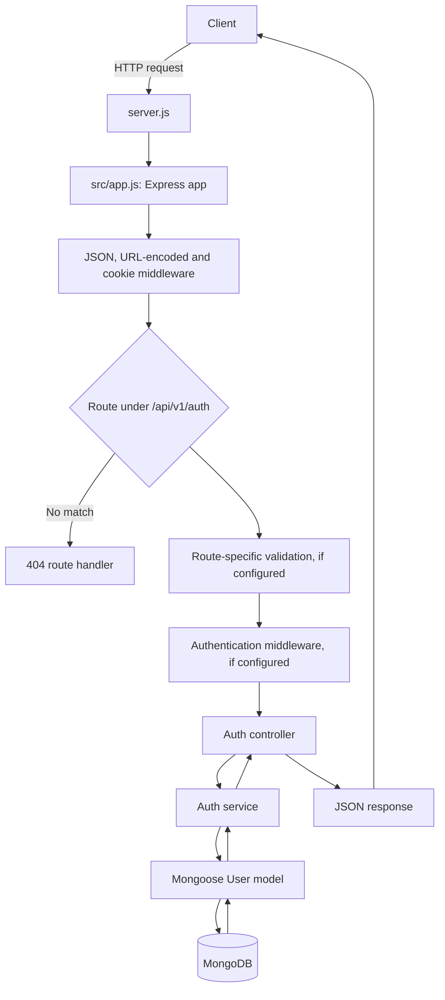

# REST API — Backend-API-Development

A Node.js and Express API project for user authentication, backed by MongoDB and Mongoose. The code defines registration, login, token, email-verification, and password-reset flows.

> **Implementation status: work in progress.** The routes show the intended API, but the application is not currently ready to run end to end. In particular, some imported DTOs and the authentication middleware are missing, request validation has a return-value mismatch, and database connection handling needs correction. See [Known implementation gaps](#known-implementation-gaps) before trying the endpoints.

## Request flow

The diagram below shows how requests are intended to pass through the code. Validation is attached only to routes that declare a DTO, and authentication middleware is attached to `/logout` and `/me`.



At startup, `server.js` loads environment variables, calls `connectDB()`, and then starts the HTTP listener. The current database helper does not correctly await the MongoDB connection, so a successful listener start does not guarantee database readiness.

## Requirements and setup

- Node.js and npm
- A MongoDB instance and its connection URI

From this directory:

```bash
npm install
cp env.example .env
```

Update `.env` with values for your environment. The application reads:

| Variable | Purpose | Runtime behavior |
| --- | --- | --- |
| `PORT` | HTTP port | Defaults to `5000` when unset |
| `NODE_ENV` | Environment mode | Used for the startup log and secure refresh-cookie setting |
| `MONGODB_URI` | MongoDB connection URI | Required by the database connection helper |
| `JWT_ACCESS_SECRET` | Signs and verifies access tokens | Must be set for token operations |
| `JWT_ACCESS_EXPIRES_IN` | Access-token lifetime | Defaults to `15m` |
| `JWT_REFRESH_SECRET` | Signs and verifies refresh tokens | Must be set for token operations |
| `JWT_REFRESH_EXPIRES_IN` | Refresh-token lifetime | Defaults to `7d` |
| `SMTP_HOST`, `SMTP_PORT`, `SMTP_USER`, `SMTP_PASS` | SMTP connection settings | `SMTP_PORT` defaults to `587` |
| `SMTP_FROM_NAME`, `SMTP_FROM_EMAIL` | Email sender identity | Used in the `From` header |
| `CLIENT_URL` | Base URL for verification and reset links | Used to construct email links |

`env.example` currently uses `SMTP_FOR_NAME` and `SMTP_FOR_EMAIL`; the email module instead reads `SMTP_FROM_NAME` and `SMTP_FROM_EMAIL`. Rename those keys in `.env` to the names the code reads. Replace the example port and token-secret values with valid values. Do not commit real credentials or secrets.

## Running

The package scripts are:

```bash
npm run dev   # Start with nodemon
npm start     # Start with Node.js
```

Both scripts run `server.js`. At present, startup is blocked by the missing imports described below, and MongoDB startup handling also needs repair. `npm test` is not configured.

The project also defines `npm run db:up` and `npm run db:down` for Docker Compose. The current `docker-compose.yml` has a malformed volume declaration, so the Compose database setup may fail; use a MongoDB instance configured separately until that file is corrected.

## Authentication API

The Express app mounts the auth router at `/api/v1/auth`. These endpoints are declared in `src/modules/auth/auth.routes.js`; their declaration does not mean they are currently operational.

| Method | Path | Purpose | Route behavior in code |
| --- | --- | --- | --- |
| `POST` | `/api/v1/auth/register` | Register a user | DTO validation, then registration controller |
| `POST` | `/api/v1/auth/login` | Authenticate a user | DTO validation, then login controller |
| `POST` | `/api/v1/auth/refresh-token` | Issue a new access token | Reads the refresh token from the `refreshToken` cookie |
| `POST` | `/api/v1/auth/logout` | Clear the stored refresh token | Requires authentication middleware |
| `GET` | `/api/v1/auth/verify-email/:token` | Verify an email address | Passes the URL token to the auth service |
| `POST` | `/api/v1/auth/forgot-password` | Request a password-reset email | DTO validation, then forgot-password controller |
| `PUT` | `/api/v1/auth/reset-password/:token` | Set a new password | DTO validation, then reset-password controller |
| `GET` | `/api/v1/auth/me` | Get the current user profile | Requires authentication middleware |

The refresh token is returned by the login service and set by the controller in an `httpOnly`, `sameSite: "strict"` cookie. It is marked `secure` when `NODE_ENV` is `production`. The access token is included in the login JSON response. The service stores a hash of the refresh token in the user record.

The registration DTO defines `name` (trimmed, 4–50 characters), `email` (valid email, lowercased), `password` (at least 8 characters), and `role` (defaults to `Customer`; accepts `Customer` or `Vendor`). The user model currently defines different role values (`customer`, `seller`, `admin`, and `support`), so the DTO and model need to be reconciled before registration can reliably save a user.

## Known implementation gaps

- `auth.routes.js` imports `LoginDto`, `ForgotPasswordDto`, and `ResetPasswordDto`, but those files are not present in the project. It also imports `authenticate` from `auth.middleware.js`, which currently exports nothing. These imports prevent the auth router from loading.
- `BaseDto.validate()` returns an `error` property, while `validate.middleware.js` reads `errors`. Invalid input therefore is not handled as intended, and the middleware can replace the request body with `null`.
- The registration controller calls `ApiResponse.created()`, but `api-response.js` currently defines `create()` rather than `created()`.
- `connectDB()` does not await `mongoose.connect()`, tries to read the connection host from the unresolved promise, and catches rather than propagates connection failures.
- The registration DTO’s role values do not match the user model’s allowed roles.
- SMTP sender variable names in `env.example` do not match those read by the email module.
- There is no configured test script or automated test suite in `package.json`.

## Project structure

```text
.
├── env.example
├── docker-compose.yml
├── package.json
├── server.js
└── src
    ├── app.js
    ├── common
    │   ├── config
    │   │   ├── db.js
    │   │   └── email.js
    │   ├── dto
    │   │   └── base.dto.js
    │   ├── middleware
    │   │   └── validate.middleware.js
    │   └── utils
    │       ├── api-error.js
    │       ├── api-response.js
    │       └── jwt.utils.js
    └── modules
        ├── auth
        │   ├── auth.controller.js
        │   ├── auth.middleware.js
        │   ├── auth.model.js
        │   ├── auth.routes.js
        │   ├── auth.service.js
        │   └── dto
        │       └── register.dto.js
        └── cart
            └── chaicode.js
```

### Main components

- `server.js` loads environment variables, connects to MongoDB, and starts the HTTP server.
- `src/app.js` configures Express middleware, mounts the auth router, and handles unmatched routes.
- `src/modules/auth/auth.routes.js` declares the authentication endpoints; `auth.controller.js` translates requests into service calls and responses.
- `src/modules/auth/auth.service.js` contains user registration, login, refresh-token, logout, email-verification, and password-reset logic.
- `src/modules/auth/auth.model.js` defines the Mongoose user schema and password hashing/comparison behavior.
- `src/common/config/db.js` and `src/common/config/email.js` configure MongoDB and email transport.
- `src/common/dto/` and `src/common/middleware/` provide shared Joi validation functionality.
- `src/common/utils/` contains API response/error helpers and JWT/token utilities.
